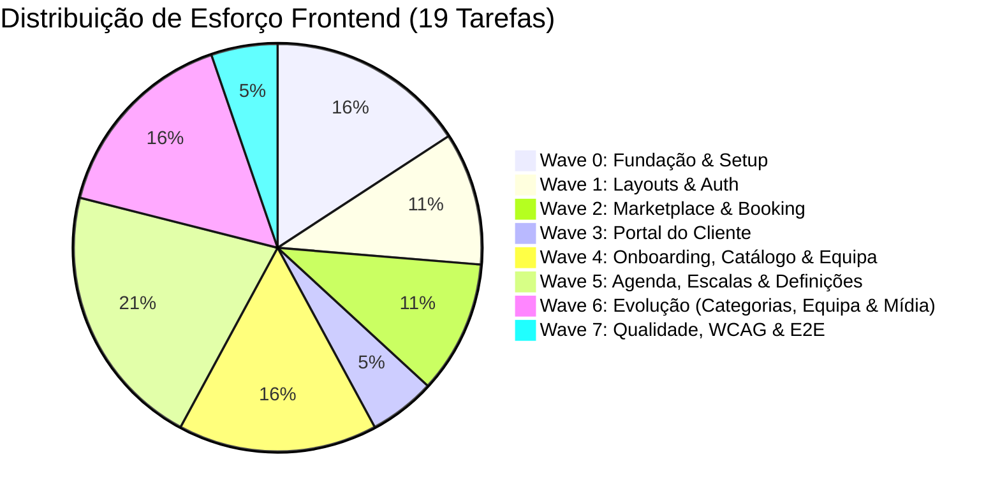

# Memória Operacional de Estado e Engenharia — Pérola Frontend

> **Documento Central de Memória Contínua (Operational Memory & Project State)**  
> Consolidação de estado do projeto, decisões de engenharia (ADRs), matriz de progresso de tarefas, rastreabilidade visual e próximos passos para o desenvolvimento da plataforma **Pérola** (Beauty & Wellness SaaS & Marketplace — Cabo Verde).

---

## 1. Identificação e Metadados do Projeto

| Metadado | Detalhe |
| :--- | :--- |
| **Projeto** | Pérola (Beauty & Wellness Platform) — Módulo Frontend |
| **Workspace** | `perola-frontend` |
| **Versão Atual** | `0.1.0` (Fase de Fundação / Pré-Scaffolding) |
| **Data da Última Atualização** | Novembro de 2026 |
| **Arquiteto & Lead Frontend** | Leonildo Gomes |
| **Projeto Google Stitch** | [https://stitch.withgoogle.com/projects/9636073377251149308](https://stitch.withgoogle.com/projects/9636073377251149308) |
| **Documentos-Fonte em `docs/`** | `docs/PRD.md` • `docs/ARCHITECTURE.md` • `docs/API.md` • `docs/DESIGN.md` • `docs/FRONTEND_SPEC.md` • `docs/FRONTEND_TASKS.md` • `docs/DOMAIN.md` • `docs/DATABASE.md` • `docs/BACKEND_TASKS.md` (não versionados) |

---

## 2. Visão Executiva & Propósito da Aplicação

O **Pérola** é uma plataforma digital integrada para o ecossistema de beleza, estética e bem-estar em Cabo Verde, unificando dois perfis fundamentais:

1. **Marketplace Público para Clientes (`/(public)` e `/(customer)`):** Descoberta geolocalizada de serviços e profissionais por Ilha e Concelho, agendamento sem atrito em 3 passos com prevenção de *overbooking* e área do cliente para gestão de histórico e avaliações.
2. **SaaS Multi-Tenant para Estabelecimentos (`/(admin)`):** Painel de gestão para proprietários e colaboradores de salões, barbearias e spas (catálogo de serviços, delegação de especialistas, motor de abertura mensal e escalas semanais com feriados de Cabo Verde, gestão de ausências e timeline de atendimentos).

---

## 3. Decisões de Arquitetura e Engenharia (ADRs Operacionais)

As decisões abaixo foram consolidadas através das especificações de produto, design e frontend, orientando todas as decisões de código:

### ADR-01: Convenção de Nomenclatura e Idioma Estrito

- **Código Técnico (100% Inglês):** Nomes de pastas, rotas Next.js, ficheiros, componentes React, interfaces TypeScript, props, funções, stores Zustand e chaves de queries TanStack Query seguem estritamente a língua inglesa (ex: `src/components/booking/SlotPicker.tsx`, `useTenantStore`, `BookingWizardContainer`).
- **Conteúdo de Apresentação e Domínio (Português de Cabo Verde):** Rótulos de interface, textos, mensagens de erro, placeholders e regras de negócio apresentam-se em português contextualizado à realidade de Cabo Verde.

### ADR-02: Localização e Regras Regionais de Cabo Verde

- **Moeda Oficial:** Escudo Cabo-verdiano (`CVE`), formatado visualmente como `1.500 CVE` ou `1.500$00` (sem suporte a moedas estrangeiras no MVP).
- **Fuso Horário Imutável:** `Atlantic/Cape_Verde` (UTC-1 constante, sem horário de verão). Todas as conversões de horários de slots e marcações respeitam este fuso.
- **Prefixos e Telefones:** Validação estrita de contactos com prefixo nacional fixo `+238` e formato móvel padrão de 7 dígitos.
- **Geografia:** Filtros e cadastros encadeados por **Ilha** (Santiago, São Vicente, Sal, Boa Vista, Santo Antão, Fogo, etc.) e **Concelho/Cidade** (Praia, Mindelo, Santa Maria, etc.).

### ADR-03: Abordagem Mobile-First Estrita e Otimização para 3G/4G

- A experiência de clientes e profissionais prioritariamente ocorre em dispositivos móveis (proporção base `375×812px` e `360×800px`).
- Alvos de toque (*touch targets*) possuem dimensões mínimas de `44×44px` (área de conforto para polegar).
- Otimização de payload, prefetching ponderado e skeletons leves para suportar conexões móveis intermitentes.

### ADR-04: Isolamento Multi-Tenant Transparente na Camada de Rede

- Nas rotas de gestão administrativa (`/(admin)/*`), todas as requisições HTTP para a API Spring Boot anexam obrigatoriamente o header:

  ```http
  X-Business-Id: <activeBusinessId-UUID>
  ```

- O identificador do salão ativo é gerido centralmente pelo `useTenantStore`, sincronizado via `localStorage` e injetado de forma transparente por interceptor HTTP (`src/lib/api/client.ts`).

### ADR-05: Resiliência Anti-Overbooking e Tratamento Concorrente RFC 7807

- Ao ocorrer conflito de slot simultâneo, o backend emite `HTTP 409 Conflict` no formato padrão `application/problem+json` (`type: slot-already-booked`).
- O frontend intercepta essa exceção com a classe especializada `SlotConflictError`.
- **Regra de UX Inegociável:** A interface **nunca** apaga o formulário ou reinicia o wizard; ela mantém os dados selecionados, emite um banner explicativo contextual e atualiza a grade de horários livres sugerindo alternativas imediatas.

### ADR-06: Stack Tecnológica Homologada

- **Framework:** Next.js (App Router, React 19 / Server & Client Components)
- **Linguagem:** TypeScript com modo estrito (`strict: true`)
- **Estilos & Primitivas:** Tailwind CSS + Radix UI via shadcn/ui
- **Estado do Servidor (Async):** TanStack Query v5 (React Query)
- **Estado Global do Cliente:** Zustand (`authStore` e `tenantStore`)
- **Formulários e Validação:** React Hook Form + Zod (schemas tipados)
- **Ícones e Toasts:** Lucide React + Sonner
- **Design Studio:** Google Stitch (Tokens Semânticos e 24 Ecrãs Mobile/Desktop)

---

## 4. Design System & Tokens Visuais (Stitch Metadata)

O visual do Pérola adota o conceito **Ocean Breeze & Modern Wellness**, unindo a sofisticação dos serviços de estética à essência das ilhas cabo-verdianas.

```yaml
stitch_theme:
  displayName: "Perola Beauty & Wellness"
  colorMode: "LIGHT"
  customColor: "#0D9488"          # Primary Teal 600 (Oceanic Breeze)
  overridePrimaryColor: "#0D9488" # Deep Teal
  overrideSecondaryColor: "#D97706" # Golden Pearl Amber
  overrideTertiaryColor: "#E11D48"  # Island Coral
  overrideNeutralColor: "#0F172A"   # Slate 900
  headlineFont: "PLUS_JAKARTA_SANS"
  bodyFont: "PLUS_JAKARTA_SANS"
  labelFont: "INTER"
  roundness: "ROUND_TWELVE"       # 12px (rounded-xl)
```

### Paleta Semântica e Estados

| Token | Cor Hex | Tailwind | Aplicação |
| :--- | :--- | :--- | :--- |
| **Primary** | `#0D9488` | `bg-teal-600` / `text-teal-600` | CTAs principais, slots selecionados, links ativos |
| **Primary Light** | `#F0FDFA` | `bg-teal-50` | Fundo de itens ativos, superfícies suaves |
| **Accent / Warning** | `#D97706` | `bg-amber-600` / `text-amber-700` | Status `PENDING`, alertas, avaliação por estrelas |
| **Destructive / Alert** | `#E11D48` | `bg-rose-600` / `text-rose-700` | Status `CANCELLED`, ações de eliminação, erros |
| **Success** | `#047857` | `bg-emerald-600` / `text-emerald-700` | Status `CONFIRMED`, confirmações de sucesso |
| **Background** | `#F8FAFC` | `bg-slate-50` | Fundo geral da aplicação |
| **Surface** | `#FFFFFF` | `bg-white` | Superfície de cards, sheets, modais e inputs |

---

## 5. Rastreabilidade com os 24 Ecrãs do Google Stitch

O projeto Google Stitch (`9636073377251149308`) contém **12 pares de telas (Mobile 375×812 + Desktop 1440×900)** cobrindo 100% dos fluxos do MVP:

| Par | Fluxo / Ecrã | ID Stitch Mobile | ID Stitch Desktop | Tarefa Associada |
| :---: | :--- | :---: | :---: | :---: |
| **Par 1** | Marketplace & Explore Feed | `9d574f9d359b4ad2bd2d7302c7ed7b56` | `771801d957934c98a383a2b255ee4a7f` | `FE-006` |
| **Par 2** | Booking Wizard (Slot Selection) | `4a9efb98dd664b0687fe58e2a7c5fb9b` | `b83777c680974992a10aeb73e9a8baf0` | `FE-007` |
| **Par 3** | Customer My Bookings Portal | `baa98502a0d44bc6a690aa0cd8f13a06` | `73a815e0065c4c1abca054b3025fc51e` | `FE-008` |
| **Par 4** | Business Admin Daily Schedule | `9bebc39e4a62413baf126b2d7e8f97bb` | `1d415fdff9fb4a5a8372a7a914079de0` | `FE-012` |
| **Par 5** | Admin Services & Staff Delegation | `d2e431bb208644299604c312016d835d` | `540ad8a3af24406183fb6bccb2c6050b` | `FE-010` |
| **Par 6** | Admin Team & Staff Management | `69ec4a2f806142929a37103dddbb75b2` | `ff1f1578365845b78867068bb6b2c4a9` | `FE-011` |
| **Par 7** | Admin Monthly Schedule Opening | `595ce8e9f0ef4f5ca592d944d805b39b` | `b74fe9cc7da342028da1fce1fc4f6703` | `FE-013` |
| **Par 8** | Admin Weekly Schedule & Breaks | `e70821380098444fbac3b2a4bfb2ecc5` | `03738b9490c64b2999c40f7e1a97053f` | `FE-013` |
| **Par 9** | Admin Time-Off & Absences | `70f629fa41af432796263a937bc1df2a` | `ac361c8601d147a7a53993645627a91f` | `FE-014` |
| **Par 10** | Business Onboarding & Settings | `b89d9f32df294d89b10db432e4cfc89e` | `87d5cf03790a413e819cca4cd7da9f31` | `FE-009` & `FE-015` |
| **Par 11** | User Authentication & Login | `7dc392df096642ba9d2e1a3bc3a7c645` | `ec9bc097f68b4497a731336183d2ff90` | `FE-005` |
| **Par 12** | User Registration & Intent Onboarding | `921e8a6f82554746811266d6d45bb16e` | `c16658ccd2d449339e08398e8f810147` | `FE-005` |

---

## 6. Matriz de Progresso e Estado das Tarefas (Implementation Waves)



### Quadro de Execução

| ID | Título da Tarefa | Onda | Prioridade | Estado | Bloqueios / Notas |
| :--- | :--- | :---: | :---: | :---: | :--- |
| **`FE-001`** | Scaffolding Next.js, Tailwind, shadcn/ui & Tokens | Wave 0 | P0 (Crítico) | 🟢 **Concluído & Validado** | Next.js 15, Tailwind, shadcn/ui e tokens configurados |
| **`FE-002`** | Cliente HTTP, Interceptores JWT/Tenant & RFC 7807 | Wave 0 | P0 (Crítico) | 🟢 **Concluído & Validado** | `src/lib/api/{client,errors}.ts` + `src/types/api.ts`; ponte de sessão `configureApiClient()` (stores registam-se em FE-003) |
| **`FE-003`** | Stores Zustand: `useAuthStore` e `useTenantStore` | Wave 0 | P0 (Crítico) | 🟢 **Concluído & Validado** | `src/stores/{auth-store,tenant-store,bridge}.ts`, `Providers` (QueryClient + hidratação) |
| **`FE-004`** | Layouts Globais: `PublicLayout` e `AdminLayout` | Wave 1 | P1 (Alto) | 🟢 **Concluído & Validado** | `(public)` + `(admin)` layouts, `MobileBottomNav`, `TenantBar`, `ActiveBusinessSelector`, `LocationSelector` |
| **`FE-005`** | Autenticação (Login Email/Google & Registo com +238) | Wave 1 | P1 (Alto) | 🟢 **Concluído & Validado** | `/login`, `/register` (RHF+Zod, +238, Google GIS, redirect por papel) |
| **`FE-006`** | Marketplace & Explore (`/(public)/explore`) | Wave 2 | P1 (Alto) | 🟢 **Concluído & Validado** | `/` e `/explore`: `ServiceFeed`, `ServiceCard`, filtros Ilha→Concelho, scroll infinito |
| **`FE-007`** | Booking Wizard & Recuperação de Conflito 409 | Wave 2 | P0 (Crítico) | 🟢 **Concluído & Validado** | `/book/[serviceId]` (3 passos), `/book/confirmed/[id]`, recuperação 409 |
| **`FE-008`** | Portal do Cliente: Minhas Marcações & Avaliações | Wave 3 | P2 (Médio) | 🟢 **Concluído & Validado** | `/(customer)/my-bookings` (abas Próximas/Histórico, Reagendar, Cancelar, Avaliar, WhatsApp) |
| **`FE-009`** | Onboarding do Salão: Cadastro do Negócio (`businesses`) | Wave 4 | P1 (Alto) | 🟢 **Concluído & Validado** | `/(admin)/onboarding` (Nome, Ilha→Concelho, Morada, Telefone +238, Live Preview, sync com `useTenantStore`) |
| **`FE-010`** | Catálogo de Serviços & Delegação de Especialistas | Wave 4 | P1 (Alto) | 🟢 **Concluído & Validado** | `/(admin)/services` (KPIs, DTOs, busca/filtros, toggle ativo, `ServiceFormModal`, `AssignSpecialistsModal`, aviso sem especialistas) |
| **`FE-011`** | Gestão de Equipa & Colaboradores (`/(admin)/team`) | Wave 4 | P1 (Alto) | 🟢 **Concluído & Validado** | `/(admin)/team` (Bento KPIs, tabela/cards, `EmployeeCard`, `EmployeeFormModal`, `AssignEmployeeServicesModal`, badge Proprietário Principal, status ativo/inativo) |
| **`FE-012`** | Agenda Diária Operacional (`/(admin)/schedule`) | Wave 5 | P0 (Crítico) | 🟢 **Concluído & Validado** | `/(admin)/schedule` (linha do tempo 08h-18h, multi-coluna por especialista, marcador live CVT, `AppointmentBlock` com ações rápidas, `NewAppointmentModal`) |
| **`FE-013`** | Disponibilidade: Abertura Mensal & Expediente Semanal | Wave 5 | P0 (Crítico) | 🟢 **Concluído & Validado** | `/(admin)/availability` (Abertura mensal com feriados CV, cards de meses, `OpenMonthModal`, expediente 7 dias, pausas, botão cópia 2ª→dias úteis) |
| **`FE-014`** | Disponibilidade: Gestão de Ausências & Férias | Wave 5 | P1 (Alto) | 🟢 **Concluído & Validado** | `/(admin)/availability` (Aba Ausências: `TimeOffTab`, `TimeOffCard`, `TimeOffFormModal`, tipos de ausência, bloqueio de agenda, badge `FOLGA HOJE`) |
| **`FE-015`** | Definições e Perfil do Salão (`/(admin)/settings`) | Wave 5 | P2 (Médio) | 🟢 **Concluído & Validado** | `/(admin)/settings` (Formulário, morada CV, switch de visibilidade pública `isActive`, `PhoneInputCV` +238, fuso `Atlantic/Cape_Verde`, live preview) |
| **`FE-016`** | Categorias Dinâmicas, Espaços Mistos (`isPrimary`) e `categoryId` em Serviços | Wave 6 | P1 (Alto) | 🟢 **Concluído & Validado** | `useCategories` (`GET /marketplace/categories`, staleTime 1h), `BusinessCategoriesSelector` (`isPrimary`), `BusinessPreviewCard` dinâmico, `ServiceFormModal` (`categoryId` UUID ordenado pelo salão) e `CategoryPills` dinâmicas |
| **`FE-017`** | Exibição e Edição da Especialidade no Perfil do Funcionário (`specialty`) | Wave 6 | P1 (Alto) | 🟢 **Concluído & Validado** | `specialty` em `Employee`, `EmployeeFormModal`, `EmployeeCard` e Passo 1 do `BookingWizardContainer` (alinhado ao DTO do backend) |
| **`FE-018`** | Componente `ImageUploadField` e Upload de Fotos (`USER_AVATAR`, `BUSINESS_LOGO`, `SERVICE_IMAGE`, `EMPLOYEE_AVATAR`) | Wave 6 | P1 (Alto) | 🟡 **Pronto p/ Início** | Upload `multipart/form-data` para `POST /api/v1/media/upload` e integração em Perfil, Salão, Serviços e Equipa |
| **`FE-019`** | Acessibilidade WCAG AA, Resiliência Offline & E2E | Wave 7 | P1 (Alto) | 🟡 **Pronto p/ Início** | Depende de `FE-008`, `FE-012`, `FE-014`, `FE-015` |

> **Legenda de Estado:**  
> ⚪ *Planeado* | 🟡 *Pronto p/ Início / Próximo Passo* | 🔵 *Em Desenvolvimento* | 🟢 *Concluído & Validado*

---

> **Nota Stitch:** os IDs de ecrã truncados nesta tabela (§5) não resolvem no MCP; usar `list_screens` do projeto. IDs completos de FE-004/FE-005 estão em `docs/FRONTEND_TASKS.md`. O ecrã usa `#00685F` nos CTAs (token `perola.deep`).

## 7. Próximos Passos Imediatos (Next Action Items)

A rota crítica de arranque segue a seguinte ordem sequencial estrita:

1. **Tarefa `FE-001` (Setup & Scaffolding):** ✅ **Concluída e Validada**
   - Configurado `package.json` com Next.js 15 (App Router), TypeScript, Tailwind CSS, shadcn/ui.
   - Fontes Google Fonts (`Plus Jakarta Sans` e `Inter`) configuradas via `next/font/google`.
   - Adicionados os tokens semânticos no `tailwind.config.ts` correspondentes ao Design System oficial (`DESIGN.md`).
   - Primitivas de UI implementadas em `src/components/ui/` (`Button`, `Card`, `Badge`, `Input`, `Dialog`, `Sheet`, `Select`, `DropdownMenu`, `Tabs`, `Switch`, `Skeleton`).
   - Build de produção verificado com sucesso (`npm run build`).
1. **Executar Tarefa `FE-002` (Infraestrutura de Rede e RFC 7807):**
   - Criar cliente API tipado (`src/lib/api/client.ts`).
   - Implementar interceptor de injeção automática de `X-Business-Id` nas rotas `/(admin)/*`.
   - Implementar interceptor de autorização JWT (`Authorization: Bearer <token>`) e fluxo de refresh token.
   - Implementar deserializador de `application/problem+json` e classe `SlotConflictError` para recuperação interativa de erros 409.
1. **✅ `FE-003` concluída (Estado Global Zustand):**
   - Implementar `useAuthStore` (token, dados do usuário, memberships).
   - Implementar `useTenantStore` (salão ativo `activeBusinessId`, persistência local e evento de troca).
1. **Prosseguir para Wave 1:**
   - **✅ `FE-004` concluída:** `PublicLayout` com `MobileBottomNav` e `AdminLayout` com `TenantBar`.
   - **✅ `FE-005` concluída:** Login e Registo com validação `+238` e Google Sign-In. Pendente (sem endpoint na API): recuperação de palavra-passe.
   - **✅ `FE-007` concluída** (Booking Wizard & recuperação 409).
   - **✅ `FE-008` concluída:** Portal do Cliente: Minhas Marcações & Avaliações (`/(customer)/my-bookings`).
   - **✅ `FE-009` concluída:** Onboarding do Salão: Cadastro do Negócio (`/(admin)/onboarding`).
   - **✅ `FE-010` concluída:** Catálogo de Serviços & Delegação de Especialistas (`/(admin)/services` com KPIs, tabela responsiva/cards mobile, `ServiceFormModal`, `AssignSpecialistsModal`, busca, filtros por categoria e aviso visual de serviços sem especialistas).
   - **✅ `FE-011` concluída:** Gestão de Equipa & Colaboradores (`/(admin)/team` com Bento KPIs, tabela responsiva/cards mobile, `EmployeeCard`, `EmployeeFormModal`, `AssignEmployeeServicesModal`, badge `Proprietário Principal`, status inativo esmaecido e validação +238).
   - **✅ `FE-012` concluída:** Agenda Diária Operacional do Salão (`/(admin)/schedule` com timeline 08h-18h, grelha multi-coluna por especialista, marcador live CVT Praia, `AppointmentBlock` dinâmico com ações imediatas de confirmação/conclusão, `NewAppointmentModal` e filtro por profissional).
   - **✅ `FE-013` concluída:** Disponibilidade: Abertura Mensal & Expediente Semanal (`/(admin)/availability` com abas segmentadas, cards de meses com status `AGENDA ABERTA` vs `AGENDA FECHADA`, `OpenMonthModal` com deteção de feriados oficiais de Cabo Verde e switches de folga/trabalho, `WeeklyScheduleForm` de 7 dias com pausas de almoço, botão de produtividade *"Copiar 2ª para Dias Úteis"*, sugestão padrão CV e seletor de especialista).
   - **✅ `FE-014` concluída:** Disponibilidade: Gestão de Ausências & Férias (`/(admin)/availability` — Tab "Ausências" com `TimeOffTab`, `TimeOffCard`, `TimeOffFormModal`, badges por tipo, indicador pulsante `FOLGA HOJE`, filtros por próximas/histórico, diálogo de confirmação de exclusão e alerta proativo de impacto).
   - **✅ `FE-015` concluída:** Definições e Perfil do Salão (`/(admin)/settings` com `BusinessSettingsContainer`, dados institucionais, dropdowns de Ilha→Concelho de Cabo Verde, `PhoneInputCV` com prefixo +238, fuso constante `Atlantic/Cape_Verde`, switch de visibilidade pública `isActive`, barra sticky de gravação e live preview card sincronizado em tempo real).
   - **✅ `FE-016` concluída:** Categorias Dinâmicas, Espaços Mistos (`isPrimary`) e `categoryId` em Serviços (`useCategories` com cache 1h, seletor multi-categoria no Onboarding e Settings com destaque de categoria principal no `BusinessPreviewCard`, seleção dinâmica de `categoryId` no catálogo de serviços priorizando as categorias do salão e pílulas dinâmicas no Marketplace).
   - **✅ `FE-017` concluída:** Exibição e Edição da Especialidade no Perfil do Funcionário (`specialty`)  em employee.
   - **🟡 `FE-018` pronto para início:** Componente `ImageUploadField` e Upload de Fotos (`USER_AVATAR`, `BUSINESS_LOGO`, `SERVICE_IMAGE`, `EMPLOYEE_AVATAR`).
   - **🟡 `FE-019` pronto para início:** Acessibilidade WCAG 2.1 AA, Resiliência Offline & Testes E2E.

---

## 8. Diretrizes para Manutenção Deste Ficheiro

- **Sincronização Contínua:** Sempre que uma tarefa (`FE-xxx`) for iniciada, altere seu estado para 🔵 *Em Desenvolvimento*. Ao ser finalizada e validada, altere para 🟢 *Concluído & Validado*.
- **Registo de Novas Decisões:** Caso surja alguma decisão técnica imprevista durante a codificação (ex: biblioteca de gráficos para dashboard, adaptação de componentes complexos do Stitch), adicione uma nova ADR na Seção 3.
- **Rastreabilidade:** Nunca remova a correlação com as telas do Google Stitch nem com os documentos em `docs/`.
